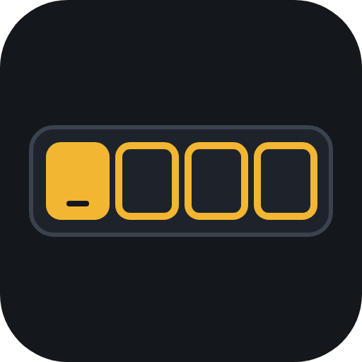

# hotbar-decky



HotBar is a plugin for [Decky Loader](https://github.com/SteamDeckHomebrew/decky-loader),
the plugin loader for SteamOS on the Steam Deck. Together with the HotBar app
it turns a phone or tablet into a keyboard, shortcut pad and pointer for games.

## What it does

- It pairs devices. The Quick Access panel shows a QR code, the app scans it,
  and both sides agree on a key that only they hold.
- It listens on the local network for encrypted commands from paired devices.
- It lets the app find this machine again when its address changes (see
  [Finding the Deck again](#finding-the-deck-again)).
- It carries out each command as keyboard or pointer input through
  `/dev/uinput`: one key press, one line of text, or one pointer event.

Everything else, such as key maps and profiles, lives in the app. The plugin
sends no input until a device is paired.

It is based on the official
[Decky plugin template](https://github.com/SteamDeckHomebrew/decky-plugin-template).

## Install

You need [Decky Loader](https://github.com/SteamDeckHomebrew/decky-loader)
on the Steam Deck.

### From the plugin store

When HotBar is listed, open the Quick Access menu, go to the Decky tab, open
the store (the shop icon at the top), find HotBar and choose Install.

While it is in review it is only on the testing store. To test it there, see
[docs/testing.md](docs/testing.md).

### From a ZIP URL

1. In Decky's settings, turn on Developer mode.
2. In the Developer section, choose Install Plugin from URL.
3. Enter the URL of `HotBar.zip` from the
   [latest release](https://github.com/Neilfau/hotbar-decky/releases/latest),
   for example
   `https://github.com/Neilfau/hotbar-decky/releases/download/v0.1.0/HotBar.zip`.
4. Confirm the install. HotBar appears in the Decky tab.

You can also copy a ZIP to the Deck and choose Install Plugin from ZIP File.

## Pair the app

1. Put the phone and the Deck on the same local network.
2. On the Deck, open the Quick Access menu, then Decky, then HotBar.
3. With no device paired, a QR code shows as soon as the panel opens. If a
   device is already paired, choose Pair another device. The code is valid
   for two minutes.
4. Scan the code with the HotBar app.
5. The device appears in the panel's list. Pair more devices the same way.

To remove one device, choose Remove next to it and confirm. Unpair all devices
removes every device at once. A removed device has to be paired again.

## Security model

- Pairing needs the QR code on the Deck's screen. It carries a one-time
  secret, so only someone who can see the screen can pair, and it expires
  after two minutes.
- Pairing agrees a key with X25519 that only the Deck and that device hold.
  Every later message is encrypted and authenticated with ChaCha20-Poly1305,
  and replayed messages are rejected.
- Each paired device has its own key, which acts as its token. Removing a
  device in the panel cuts off that device alone.
- The listener only accepts connections from the local network, and the
  plugin never logs what is typed or sent.

More detail is in [Security notes](#security-notes).

## Troubleshooting

- **The panel says "Not running".** The reason follows the words. Check the
  plugin log below.
- **The app cannot find the Deck.** Both must be on the same network, and
  some guest or office networks block devices from reaching each other. The
  app can still connect by the Deck's address.
- **Input does not reach the game.** Run the diagnose tool below. It shows
  whether the plugin runs as root and whether `/dev/uinput` is writable.

The plugin log is in `/home/deck/homebrew/logs/HotBar/`. On start the plugin
logs one `selfcheck` line per check. Each line holds a name and a value: a
Python version, `ok` or `failed`, `true` or `false`, a user id, or a time in
milliseconds. The checks cover Python, `hashlib`, `hmac`, `secrets`, `fcntl`,
`ctypes`, `aiohttp`, one X25519 shared secret and one 512-byte
ChaCha20-Poly1305 seal with the plugin's own crypto, the effective user id,
whether `/dev/uinput` opens for writing, and whether the avahi services folder
is writable. A failing check is logged and never stops the plugin.

### tools/diagnose.py

`tools/diagnose.py` reports the same machine facts from outside. Copy the
repository folder to the Deck, or just `tools/` and `py_modules/`, and run it
over SSH with `sudo`, so it has the plugin's privileges:

```bash
sudo python3 tools/diagnose.py
```

It prints the effective user id, whether `/dev/uinput` is writable, whether
`avahi-daemon` runs, whether the service file is present, and the last
`selfcheck` lines from the plugin log if the log is readable. It changes
nothing. Module and crypto results come from the plugin's own lines, because
the system Python on the Deck is not the Python Decky runs the plugin with.
Use `--log-dir`, `--uinput` or `--services-dir` if the paths differ.

To check that typing reaches a game, add `--type-test`:

```bash
sudo python3 tools/diagnose.py --type-test
```

After a 5 second countdown it types every character from space to `~` once
through the plugin's own input code. It never presses Enter. Put the cursor in
a text field before the countdown ends. The option exists only in this
command-line tool, not in the panel or on the network.

## Security notes

- The plugin runs as root, because creating input devices through
  `/dev/uinput` needs it (the `root` flag in `plugin.json`).
- The listener accepts connections from private, link-local and loopback
  IPv4 addresses only.
- Every paired device has its own key and can be removed alone in the panel.
  Removal takes effect on that device's next message.
- Keys are stored in `devices.json` in the plugin's settings directory, with
  mode 0600.
- Traffic is plain HTTP and WebSocket. Each message is sealed with
  ChaCha20-Poly1305 under a key derived for that message, and replays are
  rejected.
- The plugin never logs what is sent: no text, key codes, pointer data, keys
  or tokens.
- X25519, HKDF-SHA256 and ChaCha20-Poly1305 are written in pure Python on the
  standard library, because Decky's Python cannot load native wheels. They are
  checked against the RFC test vectors. They are not constant time.

## Layout

- `src/`: the Quick Access panel (React, built with Rollup).
- `main.py`: the Decky entry point and the calls the panel makes.
- `py_modules/hotbar/`: the backend.
  - `crypto.py`, `envelope.py`: primitives and the sealed message format.
  - `pairing.py`, `store.py`: pairing sessions and the device key file.
  - `messages.py`, `receiver.py`: message validation, replay protection and
    rate limits.
  - `input/`: the key table and the uinput devices.
  - `server.py`: the HTTP and WebSocket endpoints.
  - `advertise.py`: the avahi service file that lets the app find the Deck again.
  - `selfcheck.py`: the one-time check of Python, the crypto and the machine,
    logged when the plugin starts.
- `tests/`: Python tests, run with a stand-in for the `decky` module and fake
  input devices. `tests/vectors/` holds the protocol test vectors.
- `tools/dev_server.py`: runs the backend on a development machine with fake
  input devices.
- `tools/diagnose.py`: checks a Steam Deck over SSH.

## Requirements

- Node.js 22 with Corepack (ships with Node.js).
- [uv](https://docs.astral.sh/uv/) for the Python tests.

The backend uses the Python standard library and `aiohttp`, which Decky
Loader bundles. The panel uses
[qrcode.react](https://github.com/zpao/qrcode.react) (ISC) to draw the QR
code.

## Build the panel

```bash
corepack enable pnpm
```

```bash
pnpm install --frozen-lockfile
```

```bash
pnpm run build
```

The output is `dist/index.js`.

## Build a release ZIP

```bash
pnpm run package
```

This builds the panel and writes `out/HotBar.zip` with `tools/package.py`. The
ZIP has the layout Decky's store build produces: one `HotBar/` folder with
`LICENSE`, `README.md`, `main.py`, `package.json`, `plugin.json`, `dist/` and
`py_modules/`. Entries are sorted and carry a fixed timestamp, so the same
source gives the same bytes. Pushing a tag `v<version>` that matches
`package.json` runs the Release workflow, which attaches the ZIP to a GitHub
release.

## Run the tests

Type-check the panel:

```bash
pnpm exec tsc --noEmit
```

Run the Python tests:

```bash
uv run --python 3.14 --with pytest --with aiohttp python -m pytest
```

## Run the backend without a Steam Deck

```bash
uv run --python 3.14 --with aiohttp python tools/dev_server.py
```

It prints a pairing link and then one line per received action. No input is
injected.

## Finding the Deck again

After each start the plugin writes `/etc/avahi/services/hotbar.service`. It
announces the service type `_hotbar._tcp` on the plugin's listening port, with
two TXT records: `pid`, the plugin's id as lower-case hex, and `v=1`. The app
matches `pid`, so it can find the Deck again when the Deck's address changes.
The plugin removes the file when it stops and when it is uninstalled.

- The file is written to a temporary name and renamed, so avahi never reads a
  half-written file.
- If `/etc/avahi/services` is missing or not writable, the plugin logs one
  warning with the error type and carries on. The app can still reach the Deck
  by its last address or its `.local` name.
- If the Deck loses power or the plugin crashes, the file stays and names a
  port nobody listens on until the next start. The app checks every address it
  finds, so the cost is one failed attempt.
- The file holds no key and no token. `pid` is not secret.

## Licence

BSD-3-Clause. See [LICENSE](LICENSE).

The panel's keyboard icon is from [Font Awesome](https://fontawesome.com) by
Fonticons, Inc., used through [react-icons](https://react-icons.github.io/react-icons/)
under [CC BY 4.0](https://creativecommons.org/licenses/by/4.0/).
